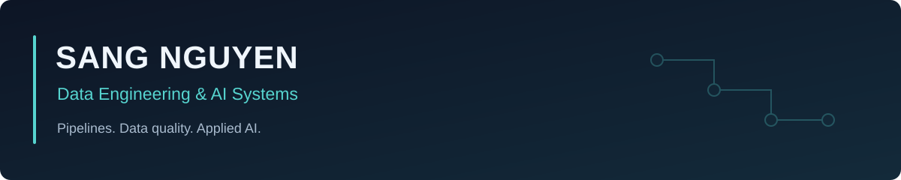

Computer Science student at **Ho Chi Minh City University of Technology (HCMUT)**, focused on data engineering and applied AI.

I build data pipelines, analytical models, and applications that make data easier to validate and use. My interests include data quality, reconciliation, dimensional modeling, and retrieval systems.

### Selected work

| Project | Engineering focus |
| :--- | :--- |
| [Walmart Retail Analytics](https://github.com/alyss1801/walmart-retail-analytics) | Python ETL, DuckDB warehouse, dimensional models, data quality checks, and React analytics. |
| [Local RAG](https://github.com/alyss1801/Local-RAG-AI-) | Local inference, hybrid retrieval, access-aware search, citations, and document lifecycle management. |
| [oHRiise](https://github.com/alyss1801/DACN_oHRiise) | HRM interaction prototype with role-aware permissions and connected approval workflows. |
| [AI 3D Asset Organizer](https://github.com/alyss1801/Star-Global) | AI-assisted classification, deterministic naming, validation, and structured metadata export. |
| [Tutor Support System](https://github.com/alyss1801/Tutor-Support-System-HCMUT) | React, Express, and PostgreSQL for tutoring sessions and role-based academic workflows. |

### Private data projects

**Bibica** · E-commerce data preparation, customer segmentation, and analytics. Private source data and detailed results remain outside this portfolio.

**Lothamilk** · Order-data reconciliation and cleaning: identifying duplicate or missing records across system inputs and flagging discrepancies in monetary values and item quantities.

These are brief project summaries; internal datasets, business figures, and implementation details are not published.

### Toolkit

**Data:** Python · SQL · pandas · DuckDB · PostgreSQL · MySQL  
**AI & backend:** FastAPI · Qdrant · Ollama · RAG · Node.js  
**Applications & delivery:** TypeScript · React · Next.js · Docker · Git

[Explore repositories](https://github.com/alyss1801?tab=repositories)
